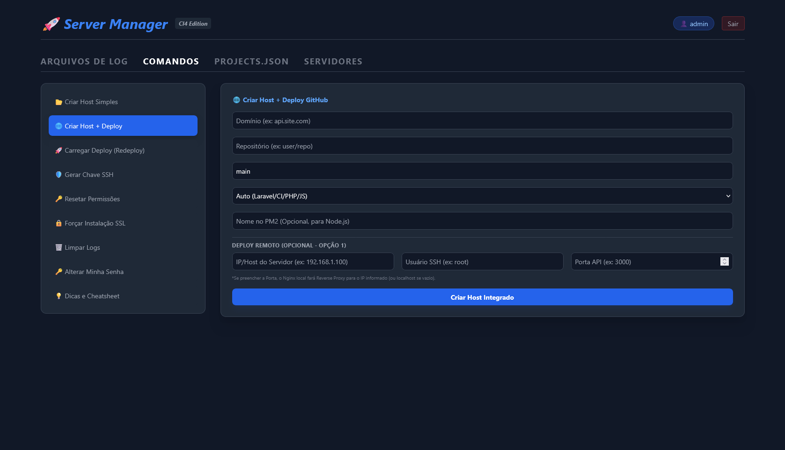

# 🚀 DeployHub & Server Manager

> **A lightweight CI/CD automation hub, Nginx VirtualHost manager, and continuous deployment engine for web servers.**

Built with **PHP (CodeIgniter 4)**, **Bash**, and **Tailwind CSS**, DeployHub automates the continuous delivery lifecycle for multi-stack applications (Laravel, CodeIgniter 4, Node.js/PM2, and static sites), provisions Nginx VirtualHosts, and provides end-to-end deployment visibility through an intuitive web dashboard.



---

## 🌟 Key Features

- 🪝 **GitHub Webhooks with HMAC-SHA256 Security**: Cryptographic payload verification on every incoming GitHub request before triggering any deployment routine.
- 🔄 **Automated Multi-Stack Deployments**:
  - **Laravel**: Automatic maintenance mode (`artisan down`), clean Git synchronization (`reset/clean`), dependency resolution (`composer install`), database migrations, asset compilation via **Vite** (`npm run build`), cache flushing, and seamless re-activation (`artisan up`).
  - **CodeIgniter 4**: Clean repository synchronization, Composer updates, and database migrations.
  - **Node.js / PM2**: Automated dependency installation, remote server deployment via SSH with pipe redirection, and graceful process restarts with **PM2**.
  - **Static / Auto / Legacy**: Fast, clean git resets and zero-friction updates.
- 🌐 **Nginx VirtualHost Generator**: Provision new web domains, server blocks, PHP sockets, and reverse proxy configurations with automated SSL setup via web forms.
- ⚙️ **Visual `projects.json` Configuration**: Manage, edit, and map repositories, branches, deployment targets, and SSH keys directly from the browser.
- 🕹️ **Manual Trigger & Rollbacks**: Trigger builds on demand with a single click from the administrative control panel.
- 📜 **Real-time Deployment Logs**: Inspect execution outputs and debugging details in `writable/logs/deploy/` tracked with `set -e` and `set -x` shell traps.
- 🔐 **Secure Authentication**: Protected sessions, Bcrypt password hashing, and in-dashboard password rotation.

---

## 🛠️ Tech Stack

- **Backend**: PHP 8.2+ / [CodeIgniter 4](https://codeigniter.com)
- **Frontend / UI**: HTML5, Vanilla JavaScript, [Tailwind CSS](https://tailwindcss.com) (Modern Dark Theme)
- **Infrastructure & Automation**: Bash Shell Scripting, Nginx, Git, SSH Keys, Composer, NPM, PM2
- **Security**: HMAC-SHA256, Bcrypt, CSRF Protection, Environment Variables

---

## 📂 Project Structure

```text
├── app/
│   ├── Controllers/
│   │   ├── Admin.php        # Host provisioning, projects management, deployments & user profile
│   │   ├── Auth.php         # Authentication and session handling
│   │   └── Webhook.php      # GitHub Webhook listener with HMAC verification
│   ├── Libraries/
│   │   └── Deployer.php     # Multi-stack shell script generation and deployment engine
│   └── Views/
│       ├── admin/           # Dashboard, Nginx manager, and project views
│       └── auth/            # Login interface
├── public/                  # Web server document root (index.php, static assets)
├── writable/
│   ├── logs/deploy/         # Real-time deployment logs per project and branch
│   ├── projects.json        # Domain mapping, branches, and deploy configurations
│   └── users.json           # User credentials and password hashes
└── .env.example             # Environment variable template
```

---

## 🚀 Getting Started

### 1. Clone the repository and install dependencies

```bash
git clone https://github.com/castrohs/webhook-cicd-manager.git
cd webhook-cicd-manager
composer install
```

### 2. Configure Environment Variables (`.env`)

Copy the environment template and customize it:

```bash
cp .env.example .env
```

Open `.env` and set your configuration:
- `CI_ENVIRONMENT = production` (or `development` for local testing)
- `app.baseURL = 'https://your-domain.com/'`
- `WEBHOOK_SECRET = 'your_secret_github_webhook_token'`
- `CERTBOT_EMAIL = 'admin@your-domain.com'`

### 3. Initialize Configuration Files

Copy the provided example files to create your initial users, project mappings, and server inventory:

```bash
cp writable/users.json.example writable/users.json
cp writable/projects.json.example writable/projects.json
cp writable/servers.json.example writable/servers.json
```

> **Default Seed Credentials:**
> - **Username**: `admin`
> - **Password**: `admin123` *(Be sure to change this immediately after your first login via the Profile menu)*

### 4. Directory Permissions

Ensure the `writable/` folder is writable by the web server user (e.g., `www-data`):

```bash
chmod -R 775 writable
sudo chown -R $USER:www-data writable
```

---

## 💻 Running in Development

To start CodeIgniter's built-in development server:

```bash
php spark serve --host 0.0.0.0 --port 8002
```

Then visit in your browser: `http://localhost:8002/login`

---

## 🔗 GitHub Webhook Integration

To connect a GitHub repository for automatic deployments:
1. In your GitHub repository, navigate to **Settings** > **Webhooks** > **Add webhook**.
2. **Payload URL**: `https://your-domain.com/webhook`
3. **Content type**: `application/json`
4. **Secret**: Enter the exact secret configured in `WEBHOOK_SECRET` inside your `.env` file.
5. **Events**: Select *Just the `push` event*.
6. Click **Add webhook**.

---

## 📄 License

Distributed under the [MIT](LICENSE) License.
